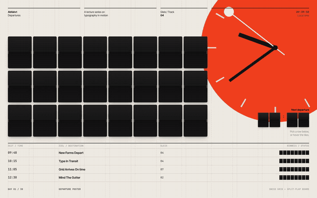

# Creative UI / 30

Thirty small, polished UI pieces, one a day: sections, transitions and Three.js scenes, built with plain HTML, CSS and JavaScript (plus Three.js on the 3D days).

**Live site:** https://yarooqh.github.io/creative-ui/ (landing page) and [/gallery/](https://yarooqh.github.io/creative-ui/gallery/) (every piece, with recordings, briefs and live demos).

Each day takes a **spark** from a reference and mixes it with an unrelated **twist**, so every piece is an original variation and never a copy of the reference. The full plan lives in the [30 Days of Creative UI](https://claude.ai/artifact/7s32SQ86SbFn23Z3hD7FY6) doc, and [`days.json`](days.json) holds the same plan in a form scripts can read.

| Day | Piece | Spark × Twist |
| --- | --- | --- |
| 01 | [Departure Poster](day-01/) | Jacqueline Casey's Swiss posters × a train departure board |



## Layout

```
index.html            Landing page: a dithered moon that fills as days are built
gallery/index.html    Gallery: filter by track, open any day in a viewer
site/                 Landing + gallery CSS/JS (data.js reads days.json)
days.json             All 30 days: brief, status, media paths. Both pages read it
.github/workflows/    pages.yml checks days.json and deploys to GitHub Pages
scripts/check-site.js Fails if a built day is missing its page or media
shared/base.css       Fonts, reset, the "All days" back link
shared/fonts/         Inter Tight + JetBrains Mono (OFL), self-hosted
shared/vendor/three/  Three.js r180 ES module build, self-hosted
scripts/record.js     Headless recorder: MP4 + GIF + poster
day-NN/
  index.html  style.css  main.js
  record.json           What the recording shows (size, length, scripted mouse)
  media/day-NN.mp4      1600×1000, 60 fps, H.264
  media/day-NN.gif      720 px wide, 25 fps
  media/poster.jpg      Gallery thumbnail
```

Everything is static and uses relative paths, so it works from any local static server and on GitHub Pages.

## Deploy

Every push to `main` runs `.github/workflows/pages.yml`: it runs `node scripts/check-site.js`, copies the site files into `_site/` and publishes them to GitHub Pages. One-time setup: **Settings → Pages → Build and deployment → Source: GitHub Actions**.

The landing page and the gallery are built entirely from `days.json`, so a new day appears on both as soon as its entry is flipped to `"built"`. Deep links: `gallery/#day-04` opens a day in the viewer, `gallery/?track=3D&built=1` filters the grid.

## Run locally

```sh
npm run serve          # python3 -m http.server 8000, then open http://localhost:8000
```

## Record a piece

```sh
node scripts/record.js day-01                    # frame-by-frame (default)
node scripts/record.js day-01 --mode realtime    # live capture fallback
node scripts/record.js day-01 --duration 6 --fps 30
```

Needs Node 18+, ffmpeg and Playwright with Chromium. In the cloud environment Playwright is preinstalled (do not reinstall it); elsewhere run `npm i -D playwright && npx playwright install chromium`.

**Frames mode** is deterministic. Before the page loads, the recorder fakes the page clock (`Date`, `setTimeout`, `requestAnimationFrame`, `performance.now`) and then, for every frame, advances the clock, steps every CSS animation, CSS transition and Web Animation by the same amount, and takes a screenshot. A heavy WebGL scene can take as long as it likes per frame and still plays back at a smooth 60 fps. Each frame is split into 4 clock sub-steps so chains of short animations do not drift.

For this to work a piece should drive its motion from the page clock: CSS animations and transitions, `element.animate()`, `requestAnimationFrame`, `performance.now()`, or GSAP (which runs on rAF). Scroll-driven CSS timelines follow the scripted scroll instead.

**Realtime mode** plays the page live and keeps Playwright's screen recording. Use it only for pieces that depend on something the fake clock cannot drive, such as `<video>` or Web Audio.

### `record.json`

```jsonc
{
  "width": 1600, "height": 1000,   // viewport
  "duration": 13, "fps": 60,
  "time": "2026-10-31T09:39:50",   // fake wall-clock time at start
  "poster": 2.7,                   // second used for poster.jpg
  "cursor": true,                  // draw a visible cursor dot
  "gif": { "width": 720, "fps": 25 },
  "actions": [
    { "at": 2.8, "move": { "selector": ".tile", "nth": 0 }, "over": 0.5 },
    { "at": 3.4, "move": [800, 500], "over": 1.0 },
    { "at": 5.9, "click": true },               // click where the mouse is
    { "at": 6.5, "click": "button.next" },      // or jump to a selector and click
    { "at": 7.0, "scroll": 1200, "over": 2.0 }, // smooth scroll to y
    { "at": 9.0, "key": "ArrowDown" },
    { "at": 9.5, "type": "hello" },
    { "at": 10, "eval": "window.someHook()" }
  ]
}
```

A `move` target is `[x, y]`, a selector string, or `{ selector, nth, dx, dy }` where `dx`/`dy` are 0–1 positions inside the element's box. Moves ease in and out over `over` seconds.

## Daily run

A scheduled cloud routine builds one piece a day with these steps. Follow them in order.

1. **Sync.** `git checkout main && git pull`.
2. **Pick the day.** Open `days.json` and take the lowest `day` whose `status` is `"planned"`. Its `spark`, `twist`, `build`, `technique` and `detail` fields are the brief. If the plan doc is reachable and its row for that day differs, the doc wins: update `days.json` to match.
3. **Design it as an original.** Never copy the spark's reference. Combine it with the twist so the piece could not be mistaken for the reference, and pick a fresh palette and type treatment unless the brief calls for continuity. Remix days (7, 14, 21, 28) start from the earlier days' folders and reuse their code.
4. **Build `day-NN/`** with `index.html`, `style.css`, `main.js`:
   - Link `../shared/base.css` and include `<a class="cu-back" href="../gallery/">← All days</a>`.
   - Use `var(--font-sans)` / `var(--font-mono)` and the self-hosted fonts. Avoid runtime CDNs. For Three.js use an import map pointing `"three"` at `../shared/vendor/three/three.module.min.js`. Vendor any addon or library you need into `shared/vendor/` with its licence.
   - Drive motion from the page clock (see Frames mode above) so the recording is smooth.
   - Make it work at 390 px wide, respect `prefers-reduced-motion`, keep it keyboard reachable, and log no console errors.
   - Keep the scope small and nail the brief's "detail".
5. **Check it.** Screenshot it with Playwright at 1600×1000 and 390×844, look at the screenshots, and fix anything that looks off. Check a mid-animation frame too.
6. **Script the recording.** Write `day-NN/record.json` so the video shows the entrance and every interaction (8–15 s). Run `node scripts/record.js day-NN`, then look at a few frames of the MP4 (`ffmpeg -ss 4 -i day-NN/media/day-NN.mp4 -frames:v 1 /tmp/f.png`). Aim for an MP4 under 10 MB and a GIF under 8 MB. If the GIF is bigger, lower `gif.width` or `gif.fps`.
7. **Update `days.json`.** Set the entry's `status` to `"built"`, `date` to today (YYYY-MM-DD), and `video`, `gif`, `poster` to its media paths. Add a row to the table in this README. Run `npm run check` and fix anything it reports.
8. **Commit and push.** One commit named `Day NN: <Title>`, pushed to `main` (or opened as a PR if the routine is set up for review). The Pages workflow redeploys the landing page and gallery on its own.

## Credits

Fonts: Inter Tight and JetBrains Mono, SIL Open Font License ([details](shared/fonts/LICENSE.md)). Three.js: MIT ([licence](shared/vendor/three/LICENSE)).
